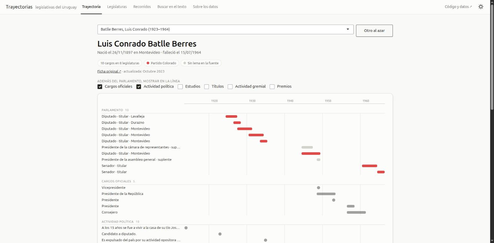
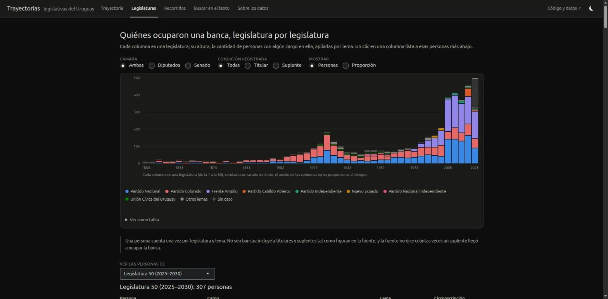
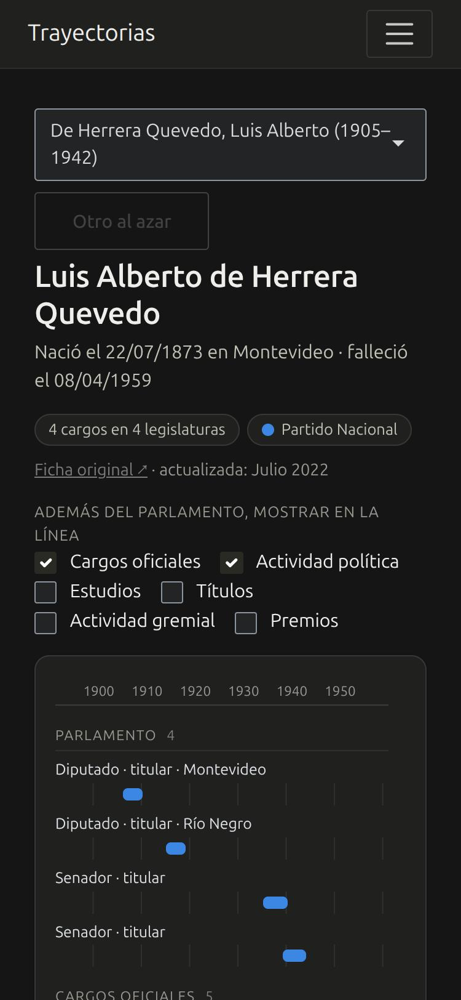
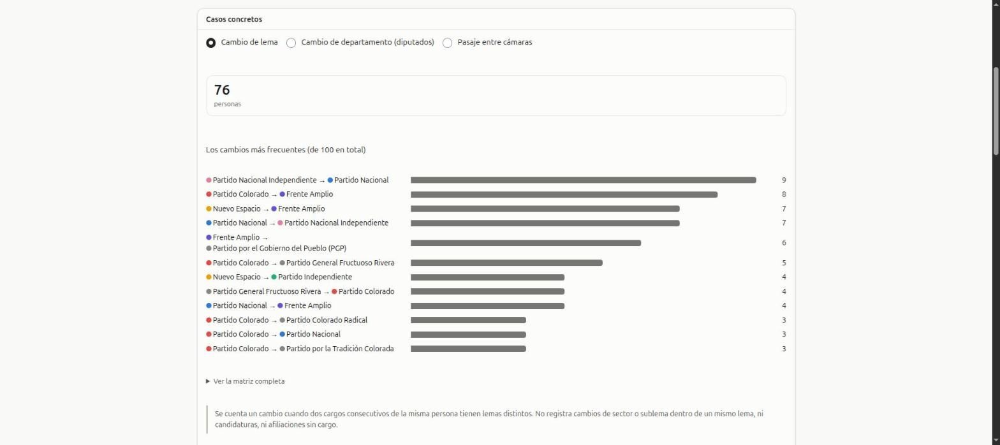

# Trayectorias legislativas del Uruguay

Las biografías de **1.816 legisladores uruguayos** —titulares y suplentes, de la primera legislatura (1830) a la
actual—, ordenadas para estudiar **trayectorias políticas**: qué cargos ocupó cada persona, en qué orden, por qué lema
y por qué departamento, y qué hizo antes y después de pasar por el Parlamento.

**[Abrir la app →](https://emilianogonlas-trayectorias-legisladores-uy.share.connect.posit.cloud/)**  ·
[Datos y diccionario](data/README.md)  ·
[Bitácora](docs/BITACORA.md)

**Fuente:** [Sistema de Consultas de Biografías de Legisladores](https://biblioteca.parlamento.gub.uy:8008/biografias/busqueda), Biblioteca del Poder Legislativo.

<p align="center">
  
</p>

La fuente publica cada biografía como una página web con texto libre. Este repositorio la baja entera y le devuelve
estructura: **una tabla por tipo de dato**, con una fila por cargo, estudio o actividad y un `id` de legislador que las
une. Encima hay una **app Shiny** para explorarlas.

## La app

| | |
|---|---|
| **Trayectoria** | Se busca una persona y se ve su línea de vida: cargos parlamentarios coloreados por lema, más cargos oficiales, actividad política y formación. Las tablas con todo el texto están debajo. Cada persona tiene enlace propio (`?persona=<id>`). |
| **Legislaturas** | Personas con algún cargo en cada una de las 50 legislaturas, apiladas por lema; filtros por cámara y condición; el listado de cada legislatura. |
| **Recorridos** | Cuántas legislaturas recorre cada persona; pasajes entre cámaras; cambios de lema y de departamento, con las personas concretas. |
| **Buscar en el texto** | Búsqueda libre en cargos oficiales, actividad política, estudios, etc., con descarga en CSV. |
| **Sobre los datos** | Fuente, cómo se comprobó, cobertura por época y lo que los datos no permiten afirmar. |

<table>
  <tr>
    <td width="68%" valign="top">
      
      <br><sub><b>Legislaturas</b> · modo oscuro</sub>
    </td>
    <td width="32%" valign="top" align="center">
      
      <br><sub><b>En el celular</b></sub>
    </td>
  </tr>
  <tr>
    <td colspan="2">
      
      <br><sub><b>Recorridos</b> · los cambios de lema más frecuentes</sub>
    </td>
  </tr>
</table>

Es liviana a propósito (gráficos en HTML/CSS, sin plotly ni ggplot2, datos precalculados en un solo `.rds`) para que
arranque rápido en el servidor gratuito. Los colores de los lemas están validados para daltonismo en modo claro y
oscuro; el detalle está en la [bitácora](docs/BITACORA.md).

## Los datos

Todo está en [`data/processed/`](data/processed), en **CSV** (diffeable) y **parquet** (tipado), con un
[diccionario columna por columna](data/README.md). El HTML crudo de la fuente no se versiona (`data/raw/`, unos 70 MB);
se vuelve a bajar con los scripts.

| Tabla | Filas | Qué es |
|---|---:|---|
| `legisladores` | 1.816 | Una fila por persona: nombre, nacimiento y defunción, lugar, y cuántas filas tiene en cada sección. |
| `cargos_legislativos` | 4.786 | Cargo, condición (titular/suplente), circunscripción, lema, sublema y lista, con el período. |
| `actividad_politica` | 8.692 | Línea de actividad política (texto libre) con lema y sector separados. |
| `cargos_oficiales` | 3.986 | Cargos fuera del Parlamento. |
| `estudios`, `titulos` | 6.966 · 1.242 | Formación. |
| `actividad_gremial`, `publicaciones`, `premios` | 4.158 · 4.422 · 1.136 | |
| `legislaturas`, `lemas` | 50 · 25 | Catálogos tomados del formulario de la fuente. |
| `listado_cargos`, `ids_estado`, `anomalias` | 4.786 · 2.399 · 85 | Control de calidad: lo que permitió validar la descarga y lo que el parseo no pudo interpretar. |

Cada fila de texto conserva `lineas_raw`, el texto tal cual salió de la fuente, para auditar cualquier interpretación.

## Cómo se reproduce

```bash
python3 -I scripts/01_listado.py      # baja las 182 páginas del listado        (~8 min)
python3 -I scripts/02_fichas.py       # baja una ficha por legislador            (~45 min)
python3 -I scripts/03_parsear.py      # HTML crudo -> data/processed/*.csv
Rscript scripts/04_a_parquet.R        # CSV -> parquet tipado
Rscript scripts/05_datos_app.R        # arma data/app/datos.rds, lo único que lee la app
Rscript -e 'shiny::runApp()'          # la app
```

Los scripts 01 y 02 son retomables y hacen un pedido por segundo. Python usa `requests` y `lxml`; la app, `shiny`,
`bslib` y `dplyr`. Para publicarla en Posit Connect Cloud: `Rscript scripts/deploy_cloud.R`.

## Estructura

```
app.R  global.R  R/  www/     la app Shiny (tiene que estar en la raíz para publicarse)
data/processed/               las tablas, en CSV y parquet
data/app/datos.rds            lo que lee la app, generado por scripts/05_datos_app.R
data/README.md                diccionario de datos
scripts/                      el pipeline numerado (01–05) y los scripts de publicación
src/trayectorias/             cliente HTTP y parser de la fuente (Python)
docs/                         bitácora de decisiones y las imágenes de este README
```

## Qué mira y qué no

- Sólo están quienes **ocuparon** una banca: no hay candidatos que no asumieron, así que no sirve para estudiar
  quién llega y quién no.
- **La cobertura cambia con la época.** La fecha de nacimiento está en ~65 % de quienes ingresaron entre 1900 y
  1939 y en ~98 % después; publicaciones y premios, al revés, caen en las cohortes recientes. No compares épocas sin
  mirar la tabla de cobertura de la app o de la [bitácora](docs/BITACORA.md).
- «Titular» y «suplente» son como los registra la fuente. No se sabe cuántas veces un suplente llegó a ocupar la banca.
- Cada cargo se ubica en la legislatura que **empieza en su año de inicio**: es una convención de este repositorio,
  no un dato de la fuente.
- Hay **170 identificadores** en la base de la fuente que devuelven error y no figuran en el listado. No sabemos quiénes son.

## Fuente y licencia

Los datos son de la **Biblioteca del Poder Legislativo** de la República Oriental del Uruguay; lo que se agrega
acá es el orden. Si los usás, citá la fuente. El repositorio todavía no tiene licencia definida para el código.
